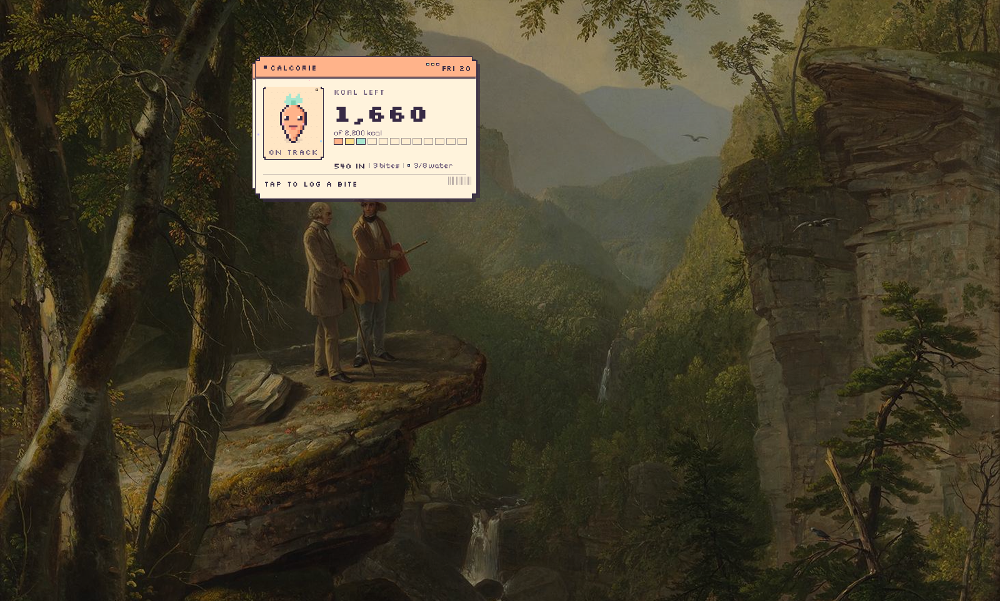
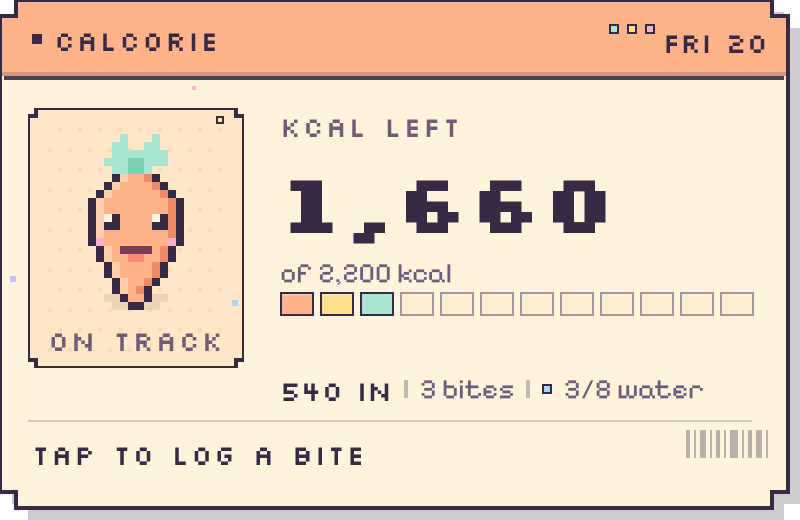
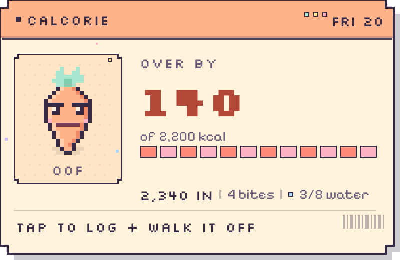
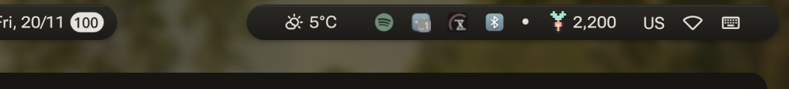
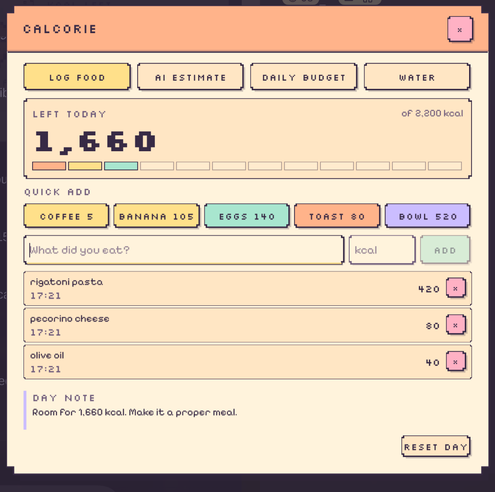
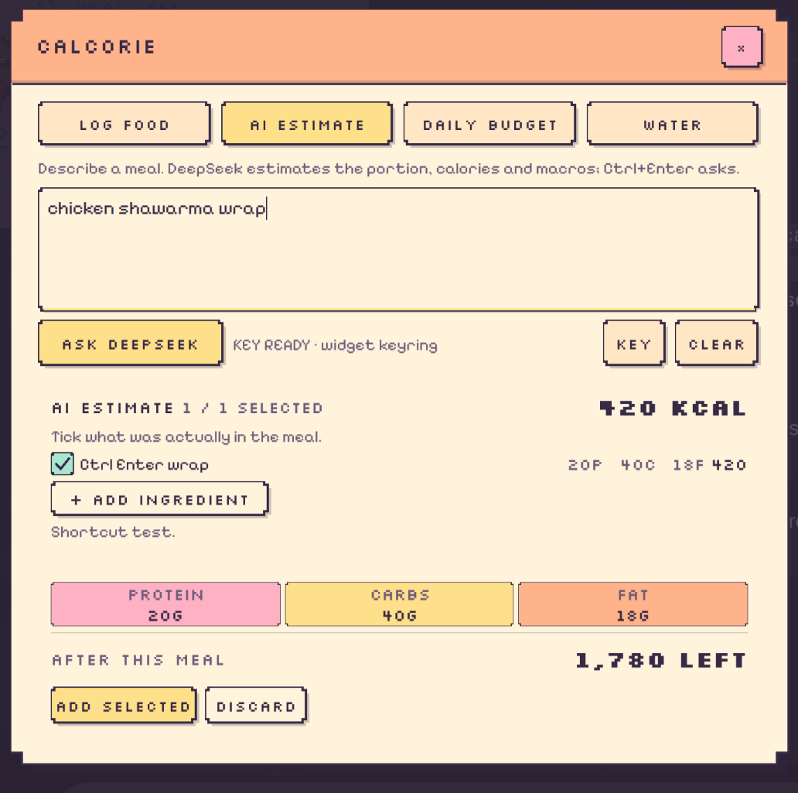
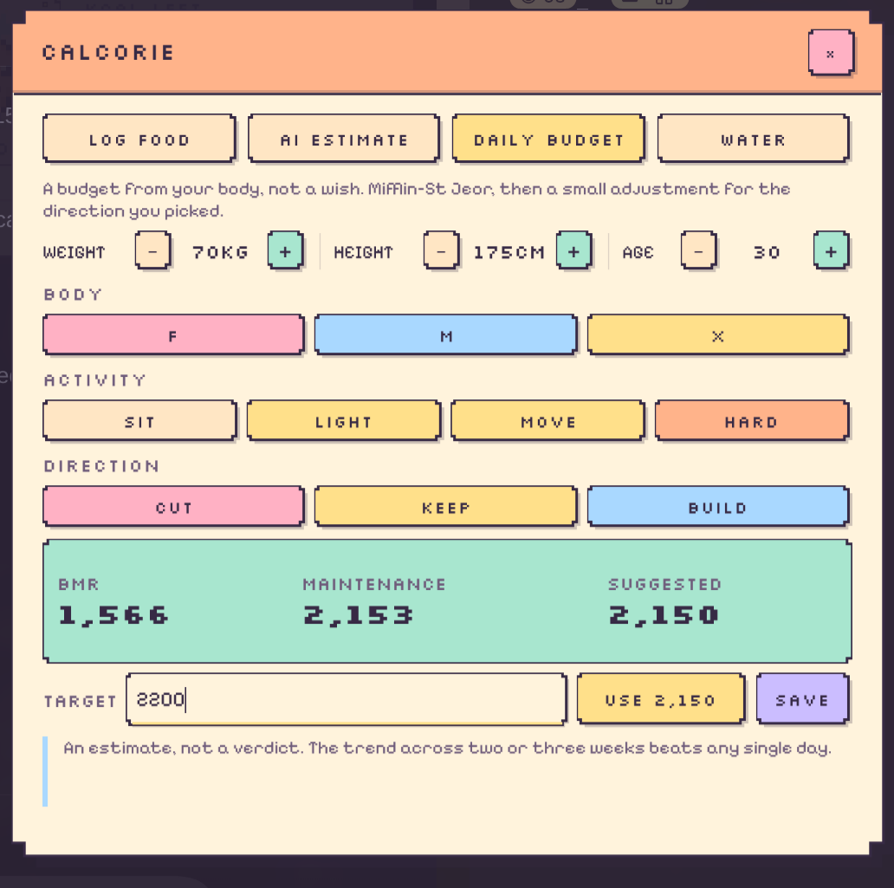
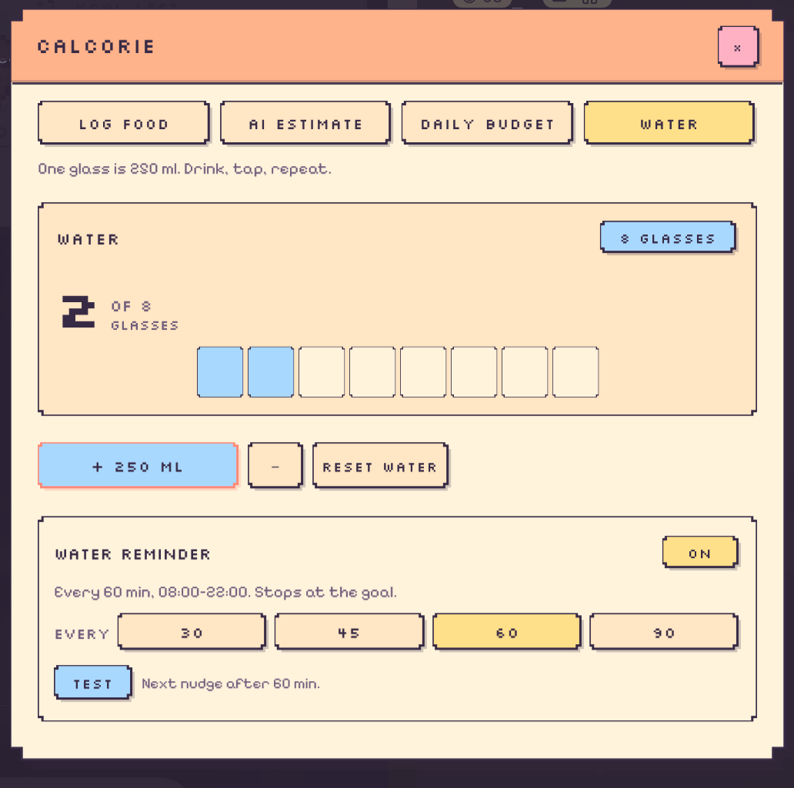
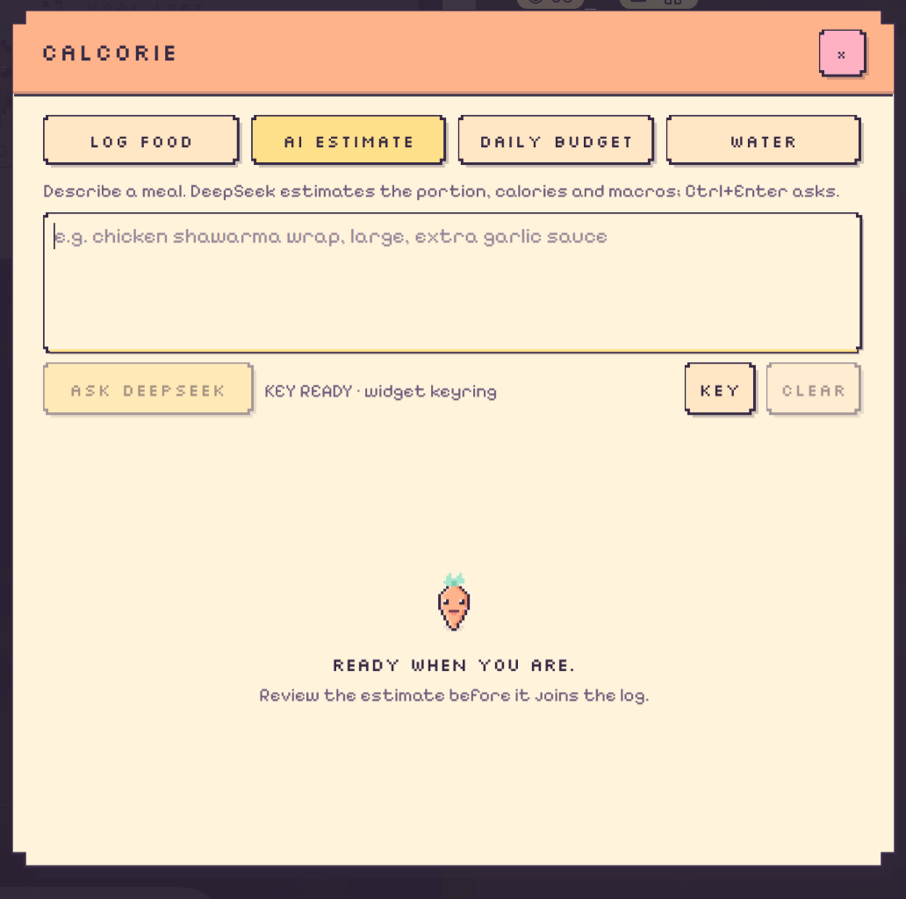

# Calcorie

A pastel pixel calorie widget for [iNiR](https://github.com/snowarch/iNiR)'s Material desktop. A cream sticker with a
cranky carrot, a segmented fuel bar and a proper little console behind it.



Built and tested on **iNiR 3.1.0**, Material family, 1707 × 1067 logical / 1.5 scale.

## What it does

- **Today's budget at a glance.** Remaining calories, a 12-block fuel bar, calories eaten and a bite count.
- **A carrot with a mood.** It perks up when you hover, squashes when you log food, and gets eyebrow-angry when you
  go over. Pixel confetti only during the half-second after a bite.
- **Log food** by name and calories, or use five quick-add chips. The list keeps today's entries and resets itself at
  local midnight.
- **Ask DeepSeek for an estimate.** Describe a meal in the AI tab; DeepSeek returns a strict-JSON list of items,
  calories and macros. Tick only the ingredients that were actually in the meal, add an extra ingredient by hand, then
  **Add selected** or discard. Totals, macros and the projected remaining calories update as you tick. The request only
  happens when you press **Ask DeepSeek** or **Ctrl+Enter** in the description box.
- **Calculate a daily budget** with Mifflin–St Jeor, an activity factor and a cut / keep / build direction. Use the
  suggestion or type a target.
- **Drink water.** One tap logs a 250 ml glass. The water tab shows the day's glasses, lets you cycle the goal
  (6/8/10/12), and can nudge you every 30/45/60/90 minutes between 08:00 and 22:00. Reminders stop at the goal.
- **Everything else local.** No account, no background process. The card does not animate at rest.

| Card | Over budget |
| --- | --- |
|  |  |

When the day is empty the card still has something to say: `screenshots/empty.png`.

The top bar also carries a tiny carrot and the remaining calories. Left-click the chip to toggle the console; right-click it to jump to **AI estimate**; middle-click it for **Water**.



| Log console | AI estimate |
| --- | --- |
|  |  |
| **Daily budget** | **Water** |
|  |  |

## Use

- Click the card to open the console. `Esc` closes it.
- Click the carrot chip in the top bar to do the same. Right-click it for **AI estimate**; middle-click it for **Water**.
- In **Log food**, type a name, press `Tab`, type calories, press `Enter`. The newest entry scrolls into view.
- In **AI estimate**, paste a DeepSeek key once. It is stored in the system keyring, not in `config.json`. You can also
  export `DEEPSEEK_API_KEY` before starting iNiR and skip the field. Describe a meal, press **Ask DeepSeek**, untick
  anything that was not in the meal, use **+ Add ingredient** for an extra one, then **Add selected**. The result
  shows the selected estimate, macros and the remaining calories after adding it. **Ctrl+Enter** in the description
  box asks immediately.

  With a key connected, the tab is ready:
  
- In **Daily budget**, use `−` / `+` for weight, height and age; pick body, activity and direction; then
  **Use 2,150** to load the estimate and **Save** to keep it.
- In **Water**, tap **+ 250 ML** for a glass. The goal button cycles 6/8/10/12. **REMINDER** toggles the nudges;
  `30/45/60/90` sets the interval. **TEST** sends one notification now.
- **Reset day** clears today's entries and water count. Press it twice; the second press confirms.

IPC, if you want a keybind:

```sh
inir calcorie toggle
inir calcorie open
inir calcorie ai
inir calcorie water
inir calcorie waterAdd
inir calcorie waterTest
inir calcorie budget
inir calcorie add "Banana" 105
inir calcorie bar true   # put the carrot chip in the top bar
inir calcorie reset
inir calcorie defaults   # empty log, neutral example profile, 2,200 kcal
```

## Install

The widget is already installed at `~/.config/inir/widgets/calcalories` and enabled as `custom.calcalories` on this
machine. To install it again, or on another iNiR machine:

```sh
cp -r widget ~/.config/inir/widgets/calcalories
inir custom-widgets reload
inir background setWidgetEnabled custom.calcalories true
inir background focusWidget custom.calcalories false
./install-bar.sh
```

`install-bar.sh` adds the bar chip to the installed Material (`ii`) bar. That registry lives in iNiR's plugin, so the script patches `BarContent.qml`, the config schema and the bar module editor, keeping `*.bak-calcalories` backups. Re-run it after an iNiR update if the chip disappears, then restart the shell.

The installed widget id is still `calcalories` (folder and `custom.calcalories` config key), and the old `inir calcalories`
command still works. That keeps existing logs, the keyring entry and the bar patch intact across the rename. New scripts
should use `inir calcorie`.

Then drag it where you want it in edit mode (`Super+W` opens widget edit mode on this setup). Scaling uses the normal
desktop-widget scale control.

### If it does not appear

- `inir custom-widgets list` should show `calcalories` with `"valid": true`.
- `inir logs --issues` should show nothing new from `Calcalories.qml`.
- `inir background widgetRects` should include `custom.calcalories`.
- If you edit the source, copy it to `~/.config/inir/widgets/calcalories` again and run `inir custom-widgets reload`.

## Data and privacy

The widget writes the calorie log and water state under `background.widgets.custom.calcalories` (and the normal
per-output override) in `~/.config/inir/config.json`: `targetKcal`, `profileJson`, `entriesJson`, `logDay`,
`waterGlasses`, `waterGoal`, `waterReminder`, `waterIntervalMin`, `waterLastReminder` and `waterDay`.

The DeepSeek key is kept in iNiR's system-keyring entry (key id `calcorie-deepseek`, falling back to the existing
`calcalories-deepseek` entry) or read from `DEEPSEEK_API_KEY`. It is never written to widget settings. A meal description leaves the machine only when you press
**Ask DeepSeek**; the request goes to `api.deepseek.com` and is not retried automatically.

The profile is a generic starting point, not a guess about you: neutral, 30 years, 175 cm, 70 kg, light activity,
maintain. Change it in **Daily budget**. Mifflin–St Jeor is an estimate, not medical advice.

## Design notes

- **Palette.** Warm paper (`#FFF3DC`), deep plum ink (`#372A45`), peach, lemon, mint, lilac, sky and rose. Fixed on
  purpose: the card is a sticker, so it keeps its colour on any wallpaper or shell theme.
- **Pixel craft.** Every border is drawn on a 2 px grid with clipped corners; the mascot is a 20 × 24 sprite drawn in
  QML `Canvas` at integer cell sizes; the barcode, LEDs and sparkles are all discrete blocks.
- **Type.** [Silkscreen](https://fonts.google.com/specimen/Silkscreen) for labels and numbers,
  [Pixelify Sans](https://fonts.google.com/specimen/Pixelify+Sans) for the reading copy. Both OFL 1.1; licences are in
  `widget/fonts/`. The console uses a 13–14 px caption/body floor, 16 px fields, 18 px title and 44 px total; the card
  uses 11–14 px labels and a 48 px number. Inputs and buttons are larger than the labels, not the other way around.
- **Less box-in-box.** The summary, day note and budget note are now ruled sections rather than nested cards. The AI
  setup card and result card remain because they are separate jobs. The panel is 680×660, not a full-screen sheet.
- **Readability.** Built against the [Web Interface Guidelines](https://github.com/vercel-labs/web-interface-guidelines)
  and the [`better-typography`](https://skills.sh/jakubkrehel/skills/better-typography) skill: 16 px inputs, a 13–14 px
  caption floor, visible focus states, truncation, and a deliberate hierarchy instead of the old 5.5–10 px labels.
- **Motion.** Hover lift, a 90 ms squash, a 360 ms elastic settle and a 520 ms confetti burst. No idle loops, and
  everything respects iNiR's `animationsActive` / power state.
- **No copied shell art.** The frame, carrot, bar and controls are original QML; the project only borrows the pixel
  discipline of [pixel-art-studio](https://github.com/Synero/pixel-art-studio), not its assets.

## Files

```
widget/
  Calcalories.qml      desktop card, state, persistence, IPC
  CalPanel.qml         layer-shell log, AI and budget console
  CalAi.qml            one-shot DeepSeek request and key handling
  CalBar.qml           top-bar chip (copied into the ii bar by install-bar.sh)
  CalCarrot.qml        tiny 9×10 carrot for the bar chip
  PixelTextArea.qml    multi-line description field
  PixelCheck.qml       pixel checkbox for AI ingredients
  CarrotMascot.qml     the 20 × 24 sprite and its moods
  PixelBox.qml         notched pixel frame on Canvas
  PixelButton.qml      chunky button with keyboard focus
  PixelField.qml       text / calorie field
  CalStepper.qml       − value + row
  CalChips.qml         segmented choices
  calpalette.js        fixed pastel palette
  calmath.js           date, parsing and the calorie maths
  calai.js             prompt, strict-JSON extraction and response validation
install-bar.sh         add/reapply the Material bar chip (backs up the ii plugin)
  widget.json          iNiR widget manifest
  fonts/               Silkscreen and Pixelify Sans + OFL
```

## Credits

- [iNiR](https://github.com/snowarch/iNiR) and [Quickshell](https://quickshell.outfoxxed.me/) for the desktop-widget
  contract.
- [pixel-art-studio](https://github.com/Synero/pixel-art-studio) for the pixel-art reference point.
- Silkscreen and Pixelify Sans, SIL Open Font License 1.1.
